# AWS CloudWatch EC2 Monitoring Lab

Monitoring an Nginx website on **Amazon EC2** with **Amazon CloudWatch**: collecting web server logs, publishing memory and disk metrics with the CloudWatch Agent, and building a CPU alarm and a dashboard.

**Region:** us-east-1 | **OS:** Amazon Linux 2023 | **Web server:** Nginx | **Monitoring:** Amazon CloudWatch

---

## What this project does

I deployed a simple website on an EC2 instance, then connected it to CloudWatch so AWS can show me whether the server is healthy. By the end of the lab I had:

- An EC2 instance running Amazon Linux 2023 with an Nginx website
- An IAM role that lets the instance send monitoring data to AWS (no access keys stored on the server)
- The CloudWatch Agent installed and configured
- Nginx access and error logs delivered to CloudWatch Logs
- Memory and disk metrics published to a custom namespace
- Standard EC2 metrics (CPU, network, status checks) collected
- A CPU utilization alarm with email notification
- A monitoring dashboard

## Architecture

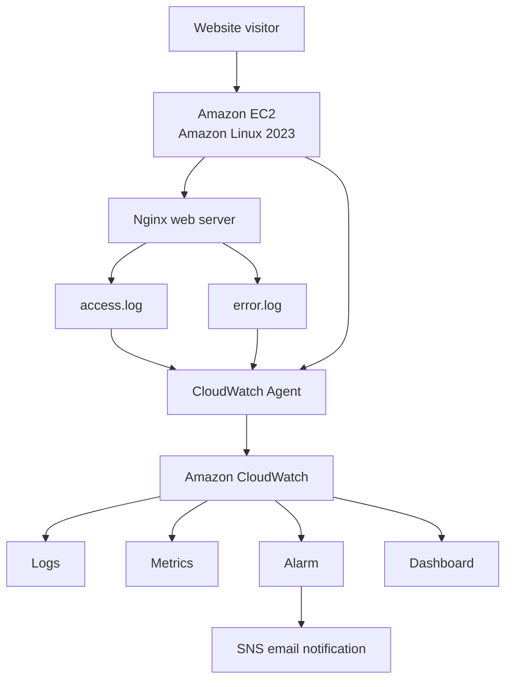

## Tech stack

| Component | Value |
|---|---|
| Cloud provider | AWS |
| Region | US East (N. Virginia), `us-east-1` |
| Instance type | `t3.micro` |
| Operating system | Amazon Linux 2023 |
| Web server | Nginx 1.30.6 |
| Monitoring | Amazon CloudWatch + CloudWatch Agent 1.300071.0 |
| Notifications | Amazon SNS (email) |

## Resource names

| Resource | Name |
|---|---|
| EC2 instance | `sufyan-cloudwatch-lab` |
| Security group | `sufyan-cloudwatch-lab-sg` |
| IAM role | `EC2CloudWatchAgentRole` |
| Custom metric namespace | `Sufyan/EC2` |
| Log groups | `/sufyan/nginx/access`, `/sufyan/nginx/error` |
| SNS topic | `sufyan-cpu-alerts` |
| Alarm | `sufyan-ec2-high-cpu` |
| Dashboard | `sufyan-ec2-monitoring` |

---

## Step-by-step guide

### 1. Launch the EC2 instance

In **EC2 > Launch instances** (region `us-east-1`):

- **AMI:** Amazon Linux 2023 (64-bit x86)
- **Instance type:** `t3.micro`
- **Key pair:** RSA `.pem` key
- **Security group** (`sufyan-cloudwatch-lab-sg`), inbound rules:

| Type | Port | Source | Purpose |
|---|---|---|---|
| SSH | 22 | My IP | Remote administration |
| HTTP | 80 | 0.0.0.0/0 | Public website |

Outbound traffic stays open so the server can install packages and reach AWS services.

### 2. Connect over SSH

```bash
chmod 400 sufyan-cloudwatch-lab.pem
ssh -i sufyan-cloudwatch-lab.pem ec2-user@<PUBLIC_IP>
```

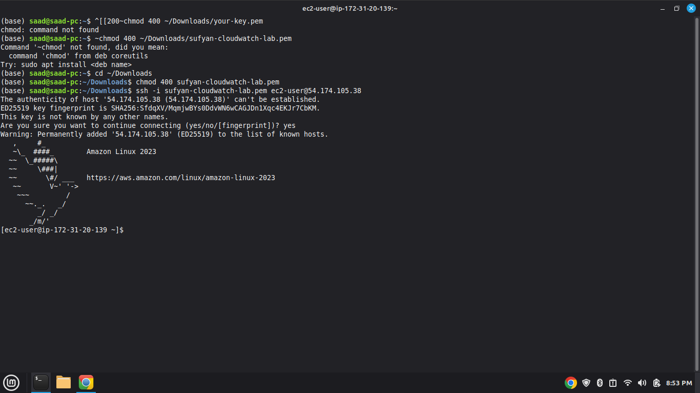

### 3. Install and start Nginx

```bash
sudo dnf update -y
sudo dnf install -y nginx
sudo systemctl enable --now nginx
sudo systemctl status nginx --no-pager
curl -I http://localhost/
```

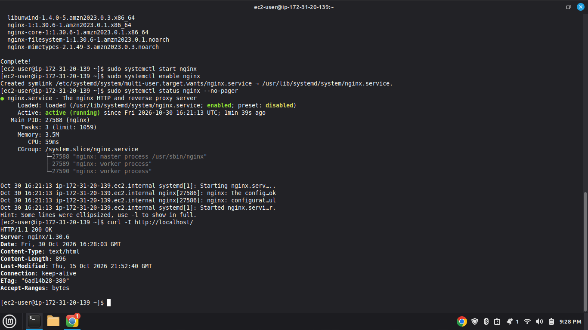

### 4. Create the website

I created a main page (`index.html`) and a test page (`cloudwatch-test-page`, deliberately without an extension) in `/usr/share/nginx/html/`.

```bash
curl -I http://localhost/
curl -I http://localhost/cloudwatch-test-page
```

Both return `200 OK`.

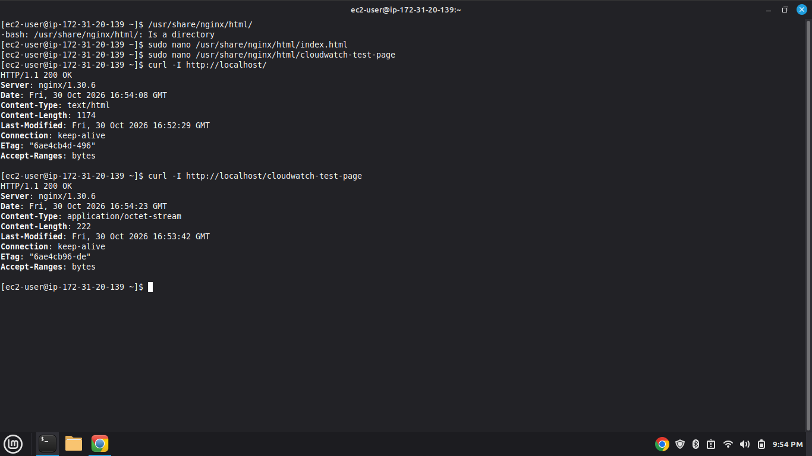

The website, opened from the browser through the instance's public IP:

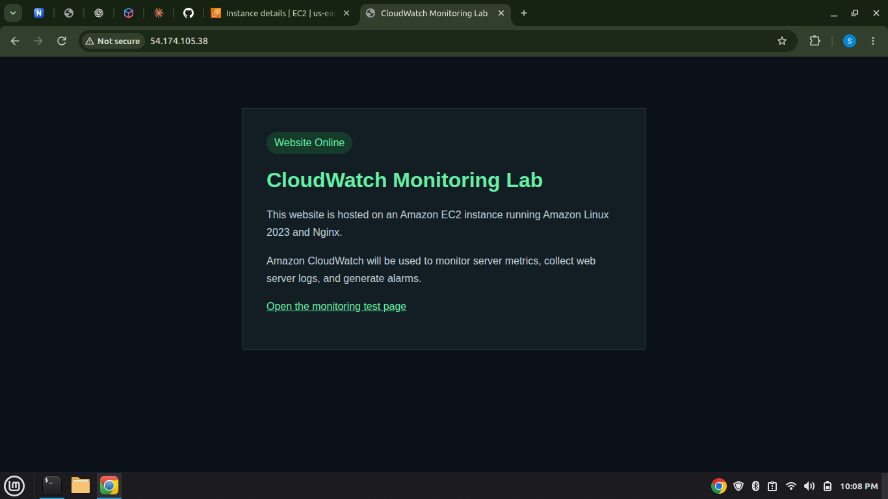

### 5. Generate sample traffic

```bash
for i in {1..10}; do curl -s -o /dev/null http://localhost/; sleep 1; done
for i in {1..10}; do curl -s -o /dev/null http://localhost/cloudwatch-test-page; sleep 1; done
sudo tail -n 20 /var/log/nginx/access.log
sudo tail -n 20 /var/log/nginx/error.log
```

The access log shows each request with its status code. The error log recorded a missing `favicon.ico` that browsers request automatically.

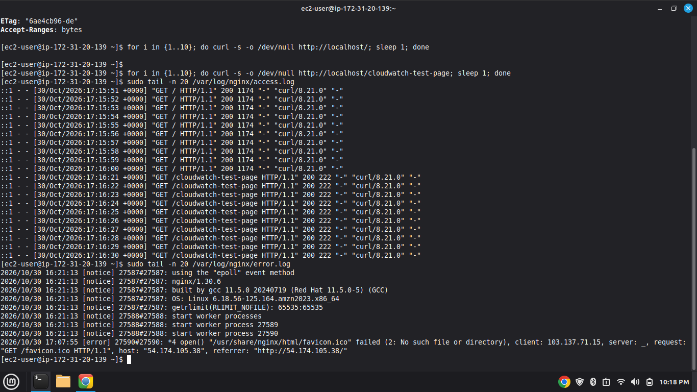

### 6. Create the IAM role

An EC2 instance has no permission to talk to CloudWatch by default. An IAM role gives it temporary credentials instead of permanent access keys.

In **IAM > Roles > Create role**:

- **Trusted entity:** AWS service > EC2
- **Policy:** `CloudWatchAgentServerPolicy`
- **Role name:** `EC2CloudWatchAgentRole`

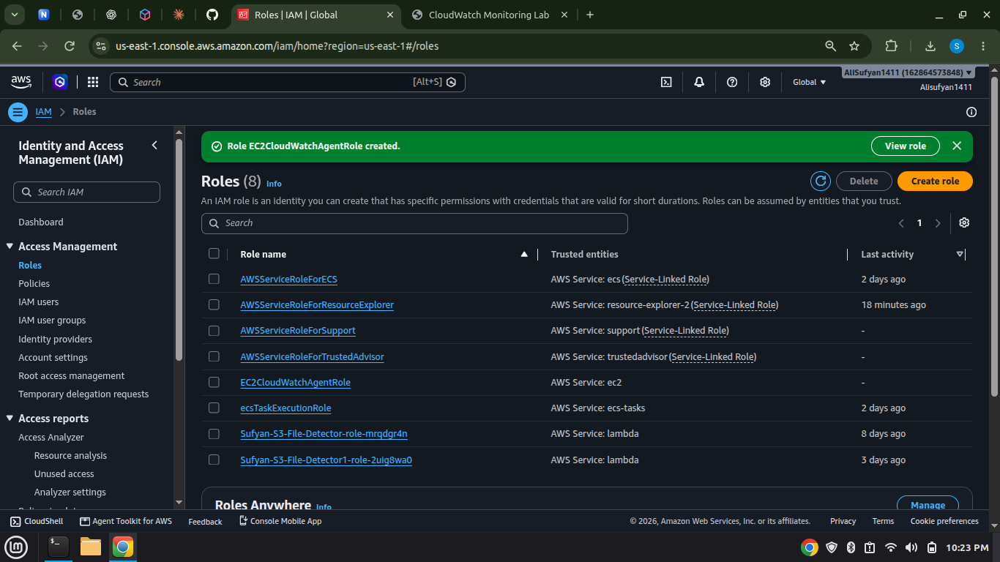

### 7. Attach the role to the instance

**EC2 > select instance > Actions > Security > Modify IAM role**

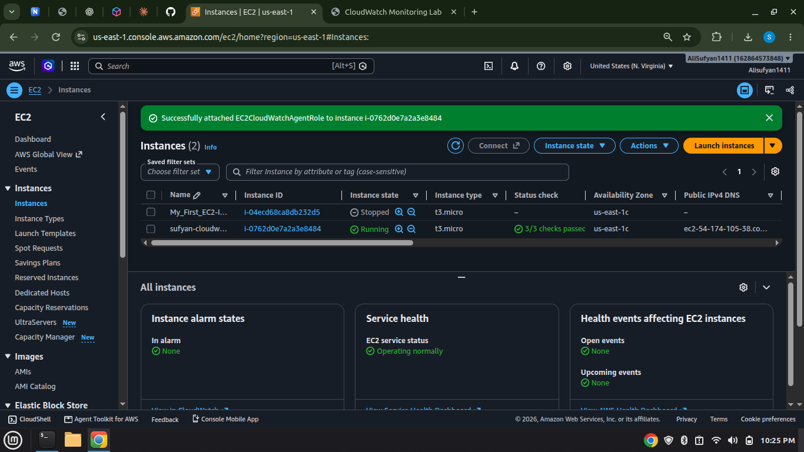

Verify from the server using IMDSv2 (this returns only the role name):

```bash
TOKEN=$(curl -sS -X PUT "http://169.254.169.254/latest/api/token" -H "X-aws-ec2-metadata-token-ttl-seconds: 21600")
curl -sS -H "X-aws-ec2-metadata-token: $TOKEN" http://169.254.169.254/latest/meta-data/iam/security-credentials/
```

Expected output: `EC2CloudWatchAgentRole`

### 8. Install the CloudWatch Agent

```bash
sudo dnf install -y amazon-cloudwatch-agent
rpm -q amazon-cloudwatch-agent
```

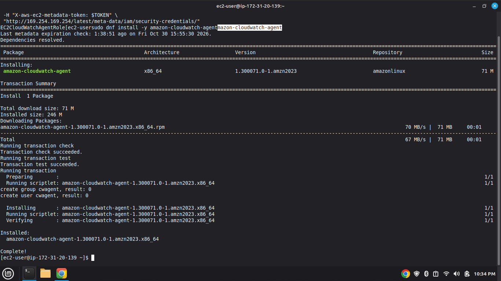

### 9. Configure the agent

The config file tells the agent which metrics to collect, which log files to forward, and where to send them. File: `/opt/aws/amazon-cloudwatch-agent/bin/config.json`

```json
{
  "agent": {
    "metrics_collection_interval": 60,
    "run_as_user": "root"
  },
  "metrics": {
    "namespace": "Sufyan/EC2",
    "append_dimensions": {
      "InstanceId": "${aws:InstanceId}"
    },
    "metrics_collected": {
      "mem": {
        "measurement": ["mem_used_percent"],
        "metrics_collection_interval": 60
      },
      "disk": {
        "measurement": ["used_percent"],
        "resources": ["/"],
        "metrics_collection_interval": 60
      }
    }
  },
  "logs": {
    "logs_collected": {
      "files": {
        "collect_list": [
          {
            "file_path": "/var/log/nginx/access.log",
            "log_group_name": "/sufyan/nginx/access",
            "log_stream_name": "{instance_id}"
          },
          {
            "file_path": "/var/log/nginx/error.log",
            "log_group_name": "/sufyan/nginx/error",
            "log_stream_name": "{instance_id}"
          }
        ]
      }
    }
  }
}
```

Validate the JSON before using it:

```bash
python3 -m json.tool /opt/aws/amazon-cloudwatch-agent/bin/config.json
```

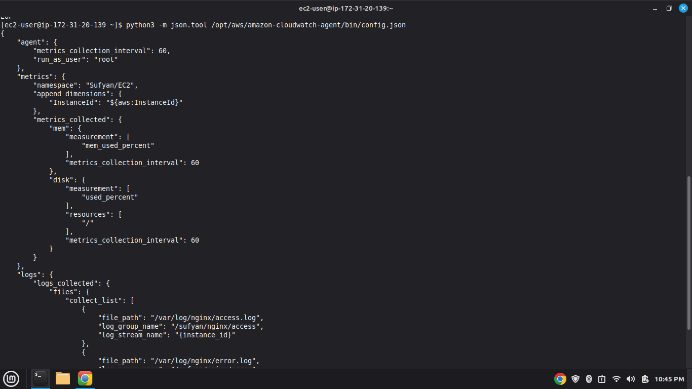

### 10. Start the agent and check its status

```bash
sudo /opt/aws/amazon-cloudwatch-agent/bin/amazon-cloudwatch-agent-ctl \
  -a fetch-config -m ec2 \
  -c file:/opt/aws/amazon-cloudwatch-agent/bin/config.json -s

sudo /opt/aws/amazon-cloudwatch-agent/bin/amazon-cloudwatch-agent-ctl -a status
```

The status shows `"status": "running"` and `"configstatus": "configured"`.

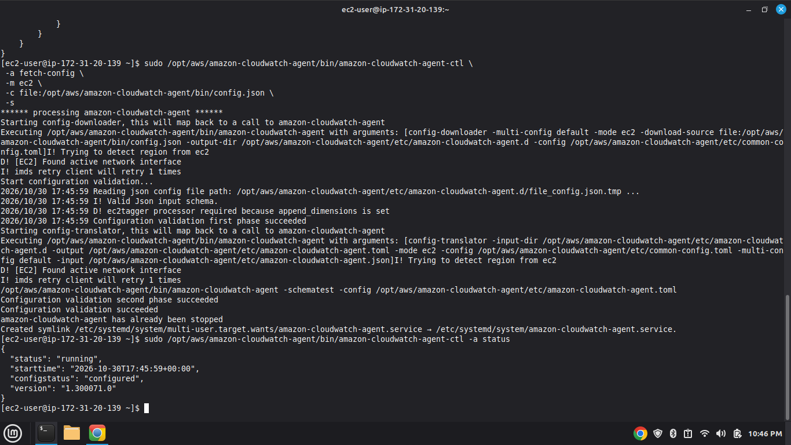

---

## Verifying the data in CloudWatch

A running agent does not guarantee delivery, so I checked that the data actually arrived.

### Log groups

Both Nginx log groups were created automatically by the agent.

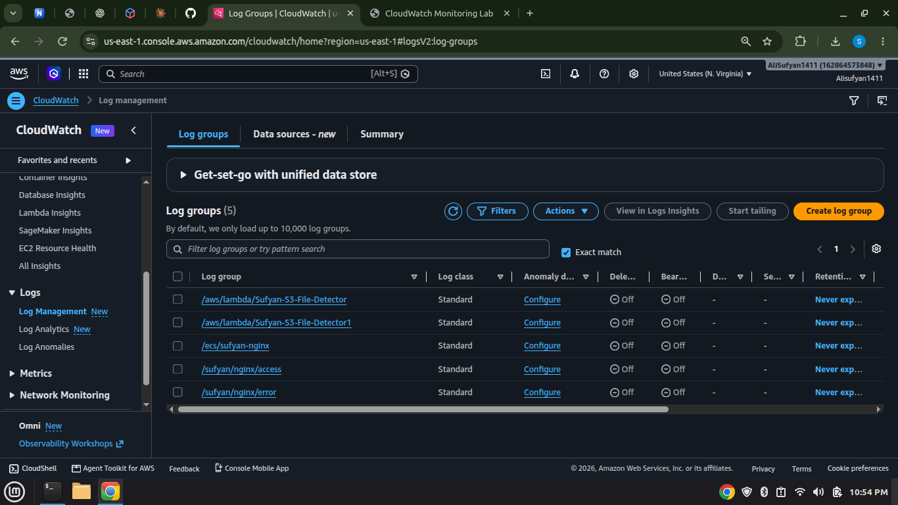

### Log events

The log stream is named after the instance ID and contains the requests generated earlier.

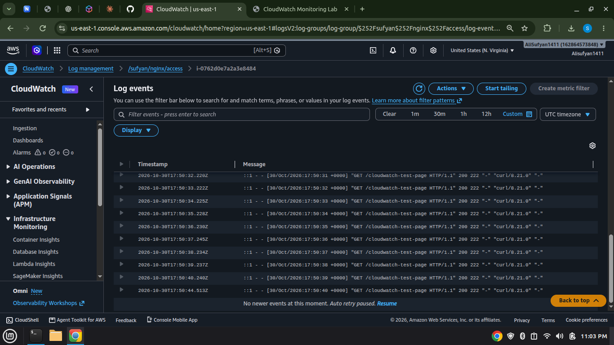

### Logs Insights query

```
fields @timestamp, @message
| filter @message like /cloudwatch-test-page/
| sort @timestamp desc
| limit 20
```

The query matched all 10 requests to the test page.

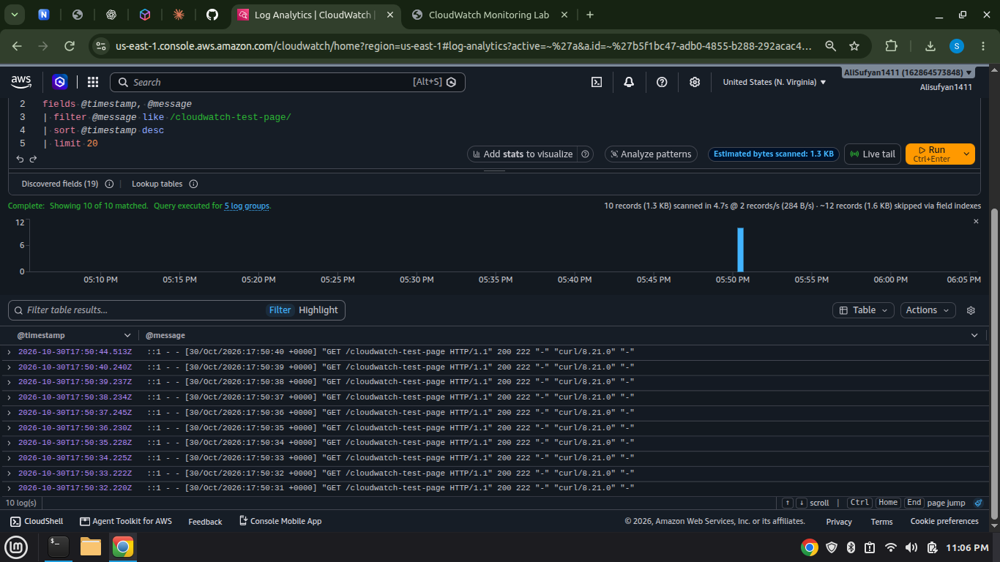

### Standard EC2 metrics

CPU utilization, network traffic and status checks are collected by AWS without the agent.

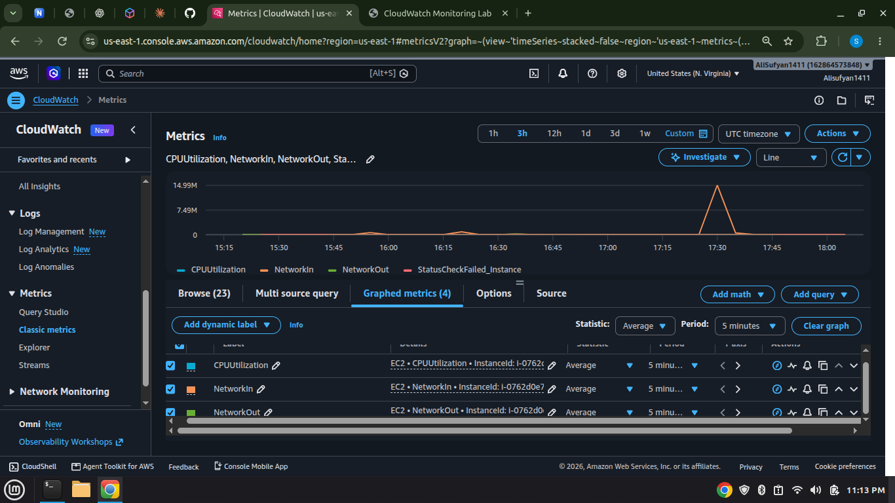

### Custom memory and disk metrics

These come from the CloudWatch Agent and appear in the `Sufyan/EC2` namespace.

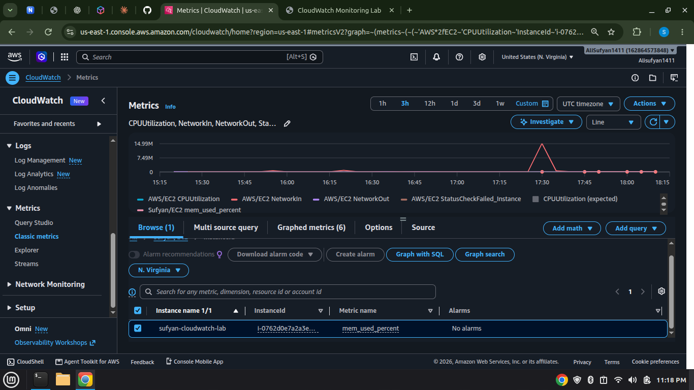

---

## CPU alarm

| Setting | Value |
|---|---|
| Metric | EC2 `CPUUtilization` |
| Statistic | Average |
| Period | 5 minutes |
| Condition | Greater than 70 |
| Datapoints to alarm | 2 out of 2 |
| Notification | SNS topic `sufyan-cpu-alerts` (email) |
| Alarm name | `sufyan-ec2-high-cpu` |

The alarm triggers when CPU stays above 70% for two consecutive 5-minute periods. A quiet website stays in the `OK` state, which is expected.

Alarm metric and settings (namespace `AWS/EC2`, metric `CPUUtilization`, Average, 5 minutes):

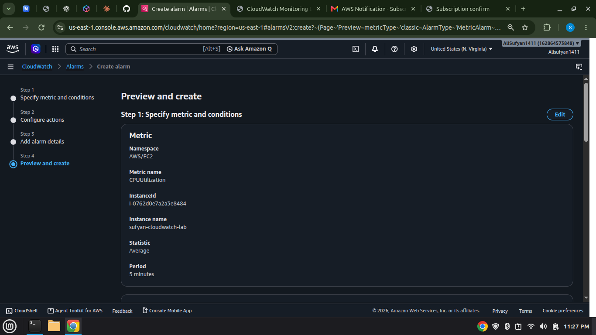

The preview graph shows the 70% threshold line. The alarm triggers when the blue line goes above the red line for 2 datapoints within 10 minutes:

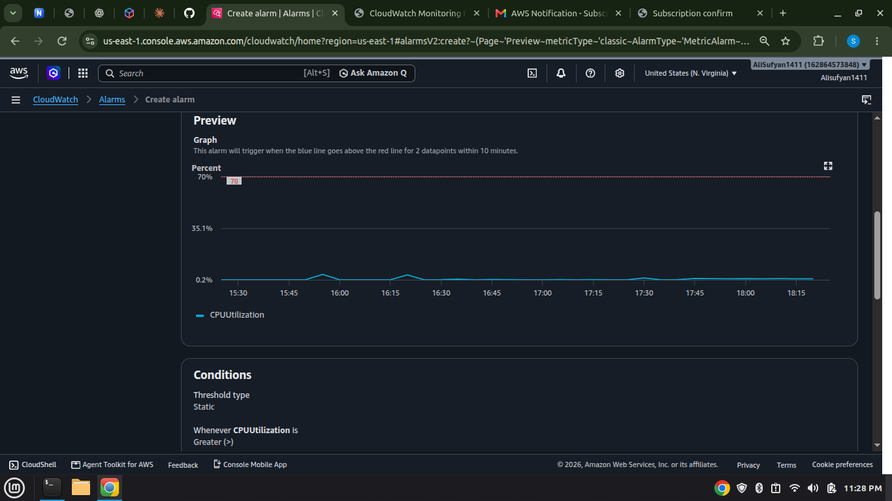

The alarm after creation. It starts as `Insufficient data` and moves to `OK` once enough datapoints arrive:

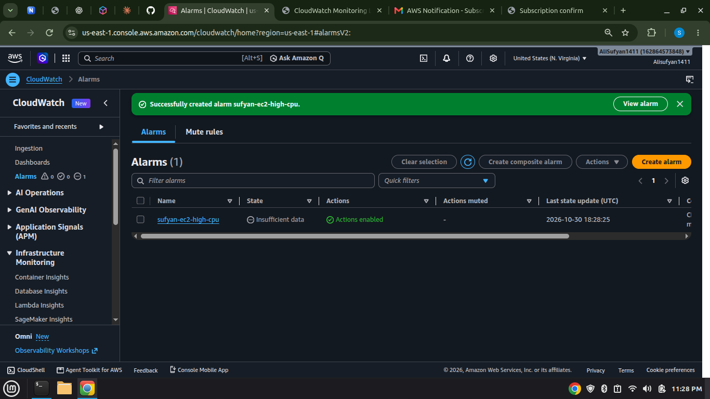

## Dashboard

`sufyan-ec2-monitoring` shows the key measurements in one place:

- CPU utilization
- Memory usage (`mem_used_percent`)
- Disk usage (`used_percent`)
- Network in and network out
- Status check failures

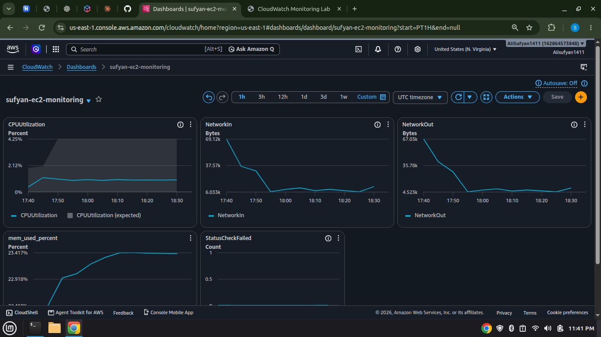

---

## Troubleshooting

### Exercise 1: create errors and find them in the logs

I requested pages that do not exist, to see how errors appear in Nginx.

```bash
for i in {1..10}; do curl -s -o /dev/null http://localhost/missing-page-$i; sleep 1; done
sudo tail -n 5 /var/log/nginx/access.log
sudo tail -n 5 /var/log/nginx/error.log
```

The access log records `404` status codes, and the error log records `No such file or directory` for each missing page.

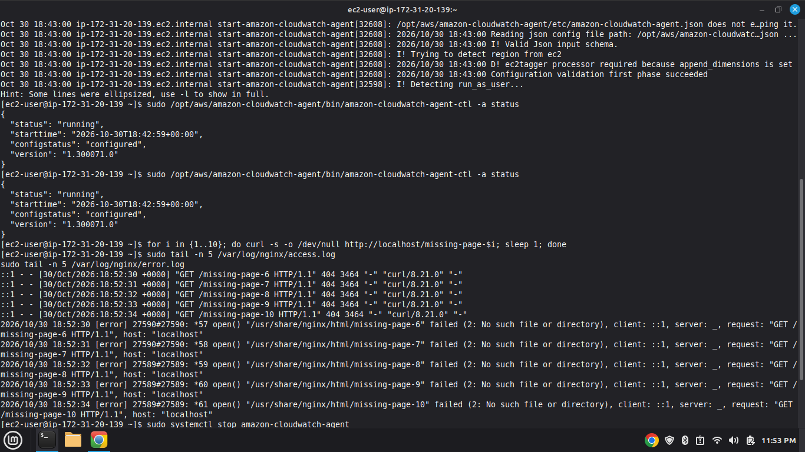

### Exercise 2: stop the agent and recover

I stopped the CloudWatch Agent, then restarted it and checked that it was healthy again.

```bash
sudo systemctl stop amazon-cloudwatch-agent
sudo systemctl restart amazon-cloudwatch-agent
sudo /opt/aws/amazon-cloudwatch-agent/bin/amazon-cloudwatch-agent-ctl -a status
sudo tail -n 20 /opt/aws/amazon-cloudwatch-agent/logs/amazon-cloudwatch-agent.log
```

After the restart the status returned to `running` and `configured`, and the agent log showed it piping both Nginx log files to CloudWatch Logs again.

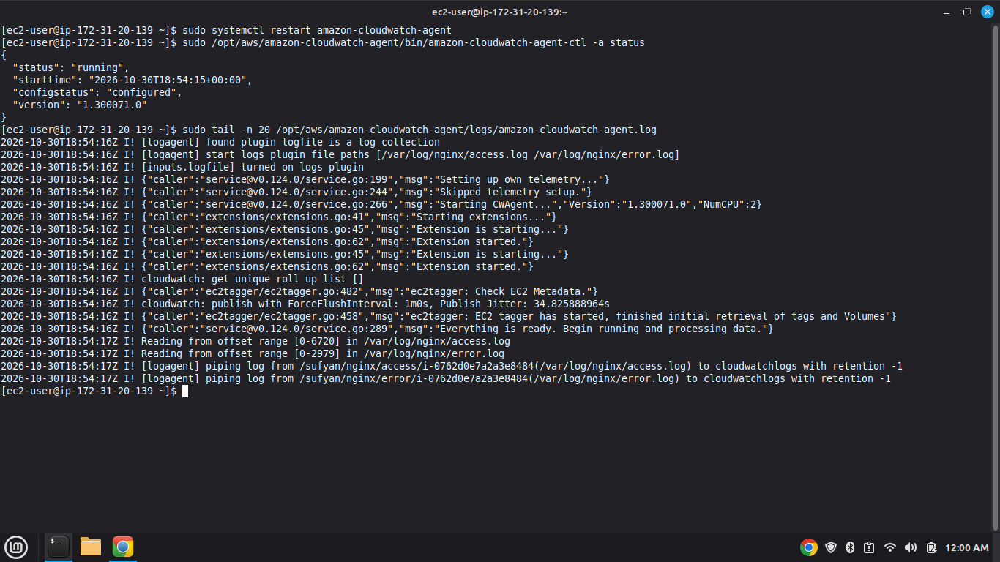

### Common problems and fixes

| Problem | What to check |
|---|---|
| Website times out in the browser | The security group attached to the instance, the port 80 inbound rule, and that the instance has a public IP. Use `http://`, not `https://` |
| SSH times out | "My IP" changes when your network changes. Update the SSH rule |
| Agent not running | `sudo systemctl status amazon-cloudwatch-agent` and the agent log at `/opt/aws/amazon-cloudwatch-agent/logs/amazon-cloudwatch-agent.log` |
| Log groups do not appear | IAM role attached, correct file paths in `config.json`, agent running, correct region |
| Credentials or AccessDenied errors | Re-run the IMDSv2 role check and confirm `CloudWatchAgentServerPolicy` is attached |
| Memory or disk metrics missing | Validate the JSON, reload the config with `fetch-config`, wait a few minutes |
| Alarm never triggers | Normal on a quiet server. Confirm the metric, threshold and evaluation periods |

Reload the agent configuration after any change:

```bash
sudo /opt/aws/amazon-cloudwatch-agent/bin/amazon-cloudwatch-agent-ctl -a fetch-config -m ec2 -c file:/opt/aws/amazon-cloudwatch-agent/bin/config.json -s
```

## What I learned

- **CloudWatch Metrics** show numbers over time (CPU, memory, disk, network), while **Logs** show what actually happened (every web request)
- The CloudWatch Agent is needed for memory and disk, because EC2 does not report them by default
- IAM roles give a server temporary credentials, so no access keys are stored on the instance
- Security groups act as the firewall: only the ports that are needed should be open
- A missing page shows up twice: as a `404` in the access log and as a "No such file or directory" entry in the error log
- A running agent still needs checking: the agent log shows whether it is actually delivering log files
- Always validate config files (`python3 -m json.tool`) before loading them
- Check the region first when something seems missing in the console

## Security notes

- SSH is restricted to my IP, and only port 80 is open to the internet
- The `.pem` key is never committed to this repository
- The IAM role uses the AWS managed policy `CloudWatchAgentServerPolicy`. For production, a custom least-privilege policy is better
- Never share the output of the instance metadata credentials endpoint

## Cleanup (avoid charges)

CloudWatch charges for log ingestion, storage, custom metrics, alarms and dashboards. When finished:

1. Stop or terminate the EC2 instance
2. Delete the alarm, dashboard and SNS topic
3. Delete the log groups, or set retention to 7 days
4. Release any Elastic IPs and delete unused key pairs

## Next steps

- Add HTTPS with a custom domain and a certificate
- Add an alarm on `mem_used_percent` and disk usage
- Create a metric filter that counts HTTP 404 and 5xx errors from the access log
- Automate the setup with a user-data script or CloudFormation

## Author

**Sufyan**, learning cloud and cybersecurity.

GitHub: [@sufyanalicloudai-maker](https://github.com/sufyanalicloudai-maker)
